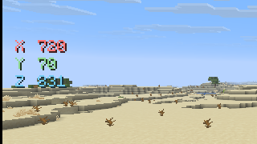
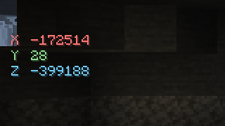

# Koordinaten-HUD: pre.10-Prüfbericht

## Prüfumgebung

Der native Minecraft-26.2-Client mit `1.2.0-pre.10+mc26.2` lief auf einem
isolierten Xvfb-Display (`:119`) innerhalb eines systemd-User-Scopes mit
`MemoryHigh=5G` und `MemoryMax=7G`. Geprüft wurden ein 1600×900-Viewport und ein
854×480-Clientfenster bei GUI-Skalierung 2. Für den Lauf wurde eine Kopie der
lokalen Testwelt verwendet; die ursprüngliche Welt sowie `options.txt` und die
lokale Visotaris-Konfiguration wurden danach wiederhergestellt.

Die Anzeige wurde für den Clientlauf über die temporäre Konfiguration
eingeschaltet. Die Einstellung ist standardmäßig aus und wird als
`display.showCoordinates` gespeichert. Die Position wird unter
`display.coordinatesPosition` gespeichert.

## Anzeige und Positionsprüfung

- Die drei Zeilen erscheinen in der Reihenfolge X, Y, Z links mittig. Die
  Minecraft-Schrift wird mit Schatten gerendert; ein zusätzlicher Panelrahmen
  wird nicht verwendet.
- X nutzt gedämpftes Rot (`#FF7777`), Y Grün (`#8ED88F`) und Z Cyan (`#72CBF2`).
- Die Anzeige liest `player.blockPosition()` und gibt nur ganze Blockwerte aus.
  Beim Test mit `720.9, 70.8, 831.1` wurden `X 720`, `Y 70`, `Z 831` gezeigt.
  Beim Test mit `-172513.168, 28.0, -399187.415` erschienen korrekt
  `X -172514`, `Y 28`, `Z -399188`; negative Werte werden also nicht Richtung
  null abgeschnitten.
- Die sechs persistenten Positionen sind links/rechts oben, mittig und unten.
  Die linke mittlere Position ist der Standard. Die Position bleibt innerhalb
  des skalierten Viewports; die Layouttests prüfen zusätzlich ein kleines
  320×180-GUI.
- Bei geöffnetem Chat blieb die Anzeige sichtbar, wie bei der übrigen HUD-Schicht.
  Im Hauptmenü ohne Spieler/Welt wurde sie nicht gerendert. F1 blendet sie über
  dieselbe bestehende HUD-Regel wie andere native HUD-Elemente aus.

## Kollisionsprüfung und Grenzen

Die mittlere linke Position hält Abstand zur typischen OPShards-/Inventaranzeige
oben links, zum Chat unten links und zur OPSUCHT-Seitenleiste rechts. In der
lokalen Testwelt waren jedoch weder das OPSUCHT-Scoreboard noch die
OPShards-Anzeige vorhanden. Der Testcharakter war im Zuschauermodus; dadurch
waren Herzen, Rüstung, Hunger und Hotbar nicht eingeblendet. Eine direkte
Kollisionsprüfung mit diesen serverseitigen bzw. Survival-HUD-Elementen war in
diesem isolierten Lauf daher nicht möglich. Die XYZ-Zeilen belegen die linke
Bildschirmmitte und liegen geometrisch außerhalb der üblichen unteren
Hotbar-/Statusleisten.

## Screenshots

Die folgenden Ausschnitte stammen aus den isolierten Clientaufnahmen. Der erste
zeigt positive Werte im 854×480-Fenster, der zweite die negativen Werte im
1600×900-Viewport.

## Automatisierte Prüfung

`CoordinateHudLayoutTest` prüft Reihenfolge und ganzzahlige Formatierung,
positive und negative `BlockPos`-Werte, fehlende Position, Renderbedingungen,
sechs Positionsanker und Viewportgrenzen. `ConfigMigrationTest` prüft
Standardwerte sowie das Speichern und erneute Laden von Aktivierung und
Position.
