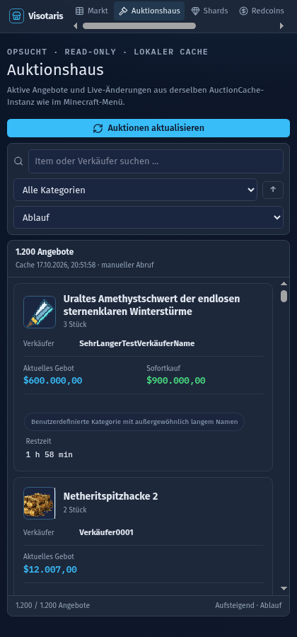

# Responsive WebUX-Datenansichten: pre.9

## Prüfumgebung

Die WebUX wurde am 17. Oktober 2026 mit Chromium 155 im headless Browser und
separatem Browserprofil geprüft. Der lokale Vite-Server stellte synthetische,
vollständig abgefangene API-Fixtures bereit. Es wurden keine Live-API-Daten
abgerufen. Die Browser-Viewports hatten Device Scale Factor 1. Es wurden
1600×900, 1180×820, 740×900 und 420×900 geprüft.

Die Fixtures enthielten 1.200 Auktionen, 180 Marktpreise, je 150 Shard- und
Redcoin-Kurse sowie 300 Händlerzeilen. Das ausgewählte Auktionsbeispiel enthielt
einen langen Itemnamen, langen Verkäufernamen, Lore mit Absatz, vier
Verzauberungen, Startgebot, aktuelles Gebot, Sofortkauf, Gebotsverlauf,
Höchstbietenden, Start-/Endzeit und UID.

## Auktionshaus

- Bei 1600×900 erscheinen zwei Kachelspalten in einem gemeinsamen scrollenden
  Ergebnisbereich neben einer eigenen Detailspalte. Die Kachel-Mindestbreite ist
  24rem; bei 1180×820 passt eine Kachelspalte neben die Details.
- Bis 920 CSS-Pixel Breite wird Master/Detail verwendet: zuerst die Kachelliste,
  nach Auswahl die Detailansicht mit „Zurück zur Liste“. Das wurde bei 740×900
  und 420×900 geprüft.
- Die Karte zeigt Icon, Itemname, Menge, Verkäufer, Kategorie, Gebot, optionalen
  Sofortkauf und Restzeit. Lange Namen werden höchstens zweizeilig, Verkäufernamen
  und Kategorien kontrolliert gekürzt.
- Details gruppieren Auktion, Preise, Beschreibung, Verzauberungen, Gebote sowie
  Zeiten und UID. Lore belegt die verfügbare Breite und erhält Leerzeilen als
  Absatzabstände. Für vier Verzauberungen erschienen „Schärfe V“, „Haltbarkeit
  III“, „Plünderung III“ und „Verbrennung II“. Bei langen Daten scrollt die
  Detailinsel intern.
- Die Fixture-Kacheln enthielten sowohl Gebot als auch Sofortkauf. Alle Preise im
  AH wurden als `$600.000,00` bzw. `$900.000,00` formatiert.

## Markt, Shards, Redcoins und Händler

- Das Marktgrid nutzt `auto-fill` und eine Mindestbreite von 250px bei größeren
  Fenstern (vorher etwa 230px). Bei höchstens 520px fällt sie auf 230px zurück;
  bei 420px füllt eine Karte 372px. Die gemessenen Grid-Spalten waren vier bei
  1600px, drei bei 1180px und eine bei 420px. Die Marktkarte bleibt dadurch
  kompakter als eine AH-Kachel.
- Listen- und Kachelansicht verwenden denselben internen Datenarbeitsbereich. Bei
  1600×900 scrollten 180 Zeilen beziehungsweise Karten im rund 494px hohen
  Datenbereich. Der Tabellenkopf blieb beim Scrollen am oberen Rand. Top 10 und
  Kategorie-Rail blieben erreichbar; auf schmalen Ansichten erscheinen
  Kategoriechips.
- Shards (1180×820), Redcoins (740×900) und Händler (420×900) hielten ihre
  150/150/300 Zeilen in internen Tabellenbereichen mit sticky Kopf und sichtbarer
  Anzahl/API-Stand-Zeile.
- Die sichtbaren Namen lauten `$` für Markt und AH, `OPShards` für Shards und
  `Redcoins` für Redcoins/Händler. Die Suche der WebUX-Quellen nach sichtbaren
  `OPS`-/`RDC`-Bezeichnungen ergab keine weiteren Treffer; Währungstargets
  `ops`/`rdc` werden in der Anzeige als unbekannt behandelt.

## Preisverlauf

Bei 1600×900 stand der große Preisverlauf links, Transaktionen und gehandelte
Items rechts darunter. Bis 1100px wird der Preisverlauf vollbreit und die beiden
kleineren Charts stehen nebeneinander; bis 700px ordnen sie sich untereinander.
ECharts passte Canvas-Breiten bei 1600, 1180, 740 und 420px an. Auf 420px bleibt
der gesamte Inhalt im eigenen Scrollbereich; die Dokumenthöhe blieb bei 900px.

## Viewport, Netzwerk und Nachweise

Für alle geprüften Ansichten entsprachen `documentElement` und `body` der
Viewportgröße; die langen Ergebnislisten verlängerten die Seite nicht. Die
1.200 AH-Kacheln wurden gleichzeitig gerendert. Beim lokalen Suchen und Scrollen
blieb die Zahl der Auction-/Kategorie-/Meta-Datenrequests im Prüfabschnitt bei
drei. Die Profilauflösung wird weiterhin nur bei Auswahl einer Auktion über den
vorhandenen Profilendpunkt angefragt; es wurde keine Anfrage pro Kachel-Render,
Hover oder Scrollen ergänzt.

## Restpunkte

Die Screenshots verwenden synthetische Testdaten, keine echten Spieler- oder
Marktdaten. Ein echter Browser mit aktiven Minecraft-Serverdaten wurde in diesem
Lauf nicht verwendet.

## Nachtest: pre.9 Padding-/Border-Fix

Am 17. Oktober 2026 wurde das Auktionshaus nach dem nachträglichen Padding- und
Border-Fix erneut in Chromium 155 im separaten Headless-Kontext geprüft. Der
Fixture-Server lieferte lokal 1.200 synthetische Auktionen, darunter lange
Item- und Verkäufernamen, eine lange Kategorie, eine lange UID, Datensätze mit
nur Gebot sowie Gebot plus Sofortkauf. Die ausgewählte Auktion enthielt lange
Lore, vier deutsche Verzauberungen und Gebotsdaten.

- Die Karten haben jetzt 16,5rem Mindesthöhe und 1,05rem Innenabstand. Bis
  520px sind es 18,5rem Mindesthöhe und 0,9rem Innenabstand; so bleibt auch die
  gestapelte Fußzeile vollständig innerhalb der Karte.
- Kategorie und Restzeit stehen in einem eigenen Meta-Footer. Ab 521px bleiben
  sie nebeneinander, bis 520px stapeln sie sich. Lange Kategorien werden mit
  Ellipse begrenzt, lange Verkäufer mit Ellipse und Itemnamen auf höchstens zwei
  Zeilen.
- Die Auswahl bleibt mit hellerem Kartenhintergrund, moderat betonter Border
  und linkem Cyan-Akzent gut erkennbar. Normale Kartenrahmen sind dezenter.
- Preise und Meta-Bereich haben mehr Abstand zu den Trennlinien und zur
  Kartenkante. Die Detailinsel hat mehr Innenabstand; Verzauberungen erscheinen
  als passive, zurückhaltende Chips.
- Bei 1600×900 wurden zwei 455,6px breite Kachelspalten neben der Detailinsel
  geprüft; bei 1180×820 eine 661,9px breite Kachelspalte neben der Detailinsel.
  Bei 740×900 blieb Master/Detail aktiv. Bei 420×900 wurden die Meta-Zeilen
  gestapelt.
- Für alle vier Größen entsprach `documentElement.scrollWidth` exakt der
  Viewportbreite. Die gemessenen Fußzeileninhalte lagen innerhalb der
  Kartenränder; lange Kategorie und Verkäufer wurden kontrolliert gekürzt.
  Browserseite und Dokumenthöhe wuchsen nicht durch die 1.200 Karten.
- Lokales Suchen und Scrollen ließen die Anzahl der Auction-/Kategorie-/Meta-
  Datenrequests bei drei; Rendering, Hover und Scrollen lösten keine zusätzlichen
  Profilanfragen aus.

Aktualisierte Nachtest-Screenshots:

